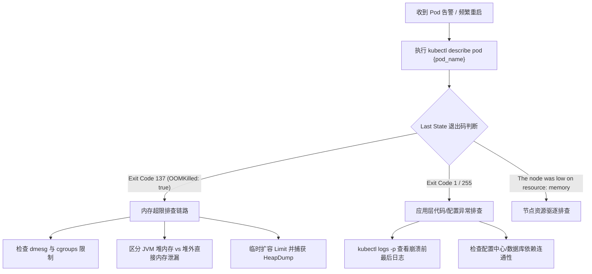

# Kubernetes 生产集群 Pod 异常崩溃与 OOMKilled 应急排障手册 (SOP)

> 文档编号: SOP-SRE-K8S-001  
> 适用范围: 生产及预发 Kubernetes 集群、微服务容器化工作负载  
> 密级: 内部生产规范  

---

## 一、故障定义与严重级别

### 1.1 核心状态定义
1. **OOMKilled (Exit Code 137)**: 容器因实际内存消耗超过了 Pod Spec 中定义的 `resources.limits.memory`，被 Linux 内核的 OOM-Killer 机制（基于 cgroups v1/v2）强制发送 `SIGKILL` 信号终止。
2. **CrashLoopBackOff (Exit Code 1 / 255)**: 容器主进程启动失败或异常退出，Kubernetes Kubelet 根据 `restartPolicy: Always` 触发指数退避重启（从 10s, 20s, 40s 直至最大 300s）。
3. **Node Eviction (驱逐)**: 宿主机节点遭遇系统级内存或磁盘压力（达到 `memory.available < 100Mi` 或 `nodefs.available < 10%` 阈值），Kubelet 主动终止低优先级 Pod。

### 1.2 故障定级标准
- **P0 级**: 生产核心网关（如 Ingress / Spring Cloud Gateway）或结算链路 Pod 存活率低于 50%，导致服务大规模报 502/504。
- **P1 级**: 单一微服务集群多个 Pod 频繁重启，触发限流或上游 RPC 超时告警。

---

## 二、标准应急排障流程 (Decision Tree)



---

## 三、关键诊断命令与排查手册

### 3.1 第一步：基础状态与事件采集
```bash
# 1. 查看 Pod 详细事件与容器退出状态
kubectl describe pod <pod_name> -n <namespace> | grep -E "Exit Code|Reason|OOMKilled|Limits"

# 2. 查看容器上一次崩溃前的遗留日志 (Previous Log)
kubectl logs <pod_name> -n <namespace> --previous --tail=200

# 3. 实时监控容器实际 CPU 与内存消耗
kubectl top pod <pod_name> -n <namespace> --containers
```

### 3.2 第二步：区分内核 OOM 与应用层 OOM
1. **内核级 OOM (Linux cgroup limit exceeded)**:
   - 现象：`kubectl describe pod` 显示 `OOMKilled: true`，但应用日志（如 catalina.out / app.log）**没有任何 `java.lang.OutOfMemoryError` 报错**，直接中断。
   - 根因：容器内包含非堆内存开销（Netty DirectByteBuffer、Metaspace、JNI 原生内存、Go Runtime 线程栈），总内存超出容器 `resources.limits.memory`。
   - 宿主机定位：
     ```bash
     # 在 Pod 所在宿主机执行，确认 cgroup 击穿事件
     dmesg -T | grep -i -E "oom-killer|killed process"
     ```

2. **JVM 堆内 OOM (`java.lang.OutOfMemoryError: Java heap space`)**:
   - 现象：应用日志明确打印 `java.lang.OutOfMemoryError`。
   - 关键排障参数：必须配置启动参数，在崩溃瞬间落盘 Dump 文件并转储至共享 PVC：
     ```bash
     -XX:+HeapDumpOnOutOfMemoryError \
     -XX:HeapDumpPath=/dumps/oom-%p.hprof \
     -XX:+ExitOnOutOfMemoryError
     ```

### 3.3 第三步：JVM 容器化最佳实践参数
在容器环境中，严禁硬编码 `-Xmx` 和 `-Xms`。必须利用 OpenJDK 容器感知参数根据 cgroups 限制动态计算：
```bash
# 推荐生产容器 JVM 参数模板
JAVA_OPTS="-XX:+UseContainerSupport \
           -XX:MaxRAMPercentage=75.0 \
           -XX:InitialRAMPercentage=75.0 \
           -XX:+UseG1GC \
           -XX:MaxGCPauseMillis=200 \
           -XX:InitiatingHeapOccupancyPercent=45 \
           -XX:+UnlockDiagnosticVMOptions \
           -XX:NativeMemoryTracking=summary"
```
> **注意**：预留 25% 的物理内存给 Linux 内核、Metaspace、线程栈（每个线程默认 1MB）以及 Netty 堆外缓冲区，避免容器被内核杀掉。

---

## 四、生产恢复与应急缓解 SOP

1. **紧急限流与止血**：
   - 若遭遇流量突增导致 OOM，第一时间在微服务网关层（Sentinel / Spring Cloud Gateway）启用 QPS 限流降级。
2. **水平扩容 (HPA)**：
   - 临时调大副本数分摊单实例内存压力：
     ```bash
     kubectl scale deployment/<deploy_name> -n <namespace> --replicas=<current_count + 5>
     ```
3. **垂直调整 Pod Limit**：
   - 如果业务模型发生结构性变化，需将 `limits.memory` 临时调大（如从 4Gi 调至 8Gi），并保留 1.5 倍 `requests.memory` 裕量。
4. **人工介入确认 (HITL)**：
   - 涉及线上节点重启或核心 Deployment 重启时，必须经过至少 1 名二级运维架构师在审计平台进行二次审批，方可执行滚动更新。
