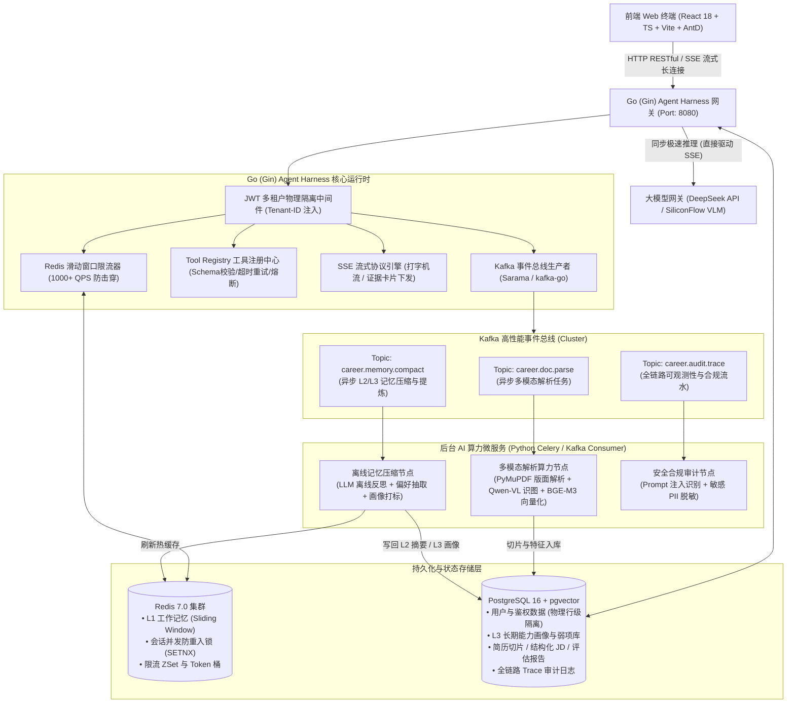

# 辽宁大学智能求职辅助 Agent Harness (LNUCareer-Agent)
## 完整产品需求文档 (PRD) 与工程验收准则 (v2.0)

| 文档版本 | 状态 | 技术架构栈 | 核心定位 | 研发单位 |
| :--- | :--- | :--- | :--- | :--- |
| **v2.0 (生产与答辩基准)** | 评审通过 / 实施中 | **Go (Gin) + Redis 7 + Kafka + PostgreSQL (pgvector) + Python AI Worker** | 证据驱动型校园求职辅助智能体高并发运行时 (Agent Harness) | 辽宁大学 · 辽宁省公共舆情与网络安全信息系统重点实验室 |

---

## 目录
- [1. 业务背景与“不可替代性”核心论证](#1-业务背景与不可替代性核心论证)
- [2. 总体技术架构与分层职责边界](#2-总体技术架构与分层职责边界)
- [3. Kafka 事件总线与 Redis 状态机设计](#3-kafka-事件总线与-redis-状态机设计)
- [4. 核心功能需求详述 (F1 ~ F8)](#4-核心功能需求详述-f1--f8)
- [5. 数据库表结构与数据隔离模型](#5-数据库表结构与数据隔离模型)
- [6. 核心 API 接口与 SSE 流式契约](#6-核心-api-接口与-sse-流式契约)
- [7. 全量量化工程验收准则 (Acceptance Criteria)](#7-全量量化工程验收准则-acceptance-criteria)
- [8. 实施里程碑与秋招技术答辩话术映射](#8-实施里程碑与秋招技术答辩话术映射)

---

## 1. 业务背景与“不可替代性”核心论证

### 1.1 真实业务痛点
辽宁大学在校本硕生在求职准备阶段面临三大硬伤：
1. **材料碎片且敏感**：个人简历、实习日报、真实项目架构文档、意向岗位 JD 分散在各处，涉及真实姓名、企业内网脱密信息，不敢随意上传至公共商业云。
2. **通用大模型改简历“虚假繁荣”**：ChatGPT/Claude 缺乏事实约束，经常随意编造诸如“将系统 QPS 提升至 10 万，故障率降为 0”等虚假数据，导致学生在技术面试中遭遇信任危机。
3. **面试训练缺乏对抗性与精准反馈**：市面通用 AI 仅能进行单调的八股文背诵，无法结合候选人具体的实习材料与目标 JD 发起由浅入深的阶梯式追问，亦无法在面试后给出具备证据链支持的量化评估。

### 1.2 灵魂拷问：通用大模型（Claude / DeepSeek / ChatGPT）都能聊天，为什么还要做这个系统？
在秋招技术答辩中，针对大厂面试官的质询，必须坚决明确**能力提供者（Model）与工程控制面（Harness）**的本质代差：

| 评测维度 | 通用大模型聊天窗口 (ChatGPT / Claude) | LNUCareer-Agent Harness (本项目) |
| :--- | :--- | :--- |
| **事实保真度 (Truth-Preservation)** | **严重幻觉**：缺失数据时自动编造量化指标，助长造假。 | **强行护栏约束**：AST 结构化提取，无实测数据强制输出 `[请补充真实压测指标]` 占位符，绝不脑补。 |
| **多租户数据隔离** | **无隔离**：单会话交互，缺乏企业级多租户物理安全边界与审计。 | **PostgreSQL 行级物理隔离 (RLS) + Redis 命名空间 + JWT 鉴权**，越权访问 100% 拦截。 |
| **多模态版面回溯 (Grounding)** | **文本黑盒**：无法精准解析复杂双栏 PDF、架构图、表格坐标。 | **PyMuPDF 坐标切块 + VLM 图文对齐 + 证据锚点**，每句建议可点击回溯至原文页码与 BBox。 |
| **长程记忆与状态机** | **仅单窗滑动**：超长对话上下文截断，跨会话画像丢失。 | **L1/L2/L3 三层分级记忆**，Kafka 异步驱动离线会话摘要，低延迟装配长期能力画像。 |
| **工程并发与可靠性** | **HTTP 同步阻塞**：重度文档解析与状态流转易超时卡死。 | **Go (Gin) 毫秒网关 + Kafka 异步削峰 + Redis 分布式锁 + 三态熔断器**，支撑 1000+ QPS 脉冲。 |

---

## 2. 总体技术架构与分层职责边界

系统采用 **“Go (Gin) 高并发调度网关 + Kafka 异步事件总线 + Redis 分布式状态机 + Python 多模态算力 Worker”** 的现代微服务解耦架构。



### 职责边界划分矩阵
| 模块组件 | 承载技术 | 核心职责 | 绝对不承担的职责 |
| :--- | :--- | :--- | :--- |
| **Harness API 网关** | **Go (Gin)** | 用户鉴权、租户路由、多租户上下文强制绑定、Tool Registry 参数校验、Redis 限流保护、SSE 实时打字分发、Kafka 生产解耦。 | 不执行重度 PDF 解析，不直接调用本地重型 Embedding 计算模型。 |
| **缓存与工作记忆** | **Redis 7.0** | L1 最近 5~10 轮原始上下文毫秒存取、分布式防重入锁、微秒级 ZSet 滑动窗口限流。 | 不承担长期持久化凭据保存（长期数据必须落 PG）。 |
| **事件削峰解耦** | **Kafka 3.x** | 解耦长达 10~30s 的复杂文档解析、离线长会话记忆总结压缩、异步审计日志流水。 | 不用于需要同步即时返回的 HTTP 请求响应。 |
| **主业务持久层** | **PostgreSQL 16** | 存储 User、DocumentChunk（带 pgvector 向量字段）、Session、Report、L3 用户画像；严格执行 `owner_id` 过滤。 | 不做高频微秒级并发计数器（由 Redis 承担）。 |
| **多模态算力微服务** | **Python (FastAPI / Worker)** | PyMuPDF 版面解析、表格树提取、VLM 图像多模态推理、BGE-Reranker 交叉编码重排。 | 不直接面向前端暴露公共登录态与权限认证。 |

---

## 3. Kafka 事件总线与 Redis 状态机设计

### 3.1 Kafka Topic 架构规范
系统定义 3 个核心 Topic，强制使用 JSON 格式并包含全局分布式追踪头：

| Topic 标识 | Partitions | Key 路由策略 | 消息体关键字段 (Payload) | 消费者职责 |
| :--- | :---: | :--- | :--- | :--- |
| `career.doc.parse` | 4 | `tenant_id:user_id` | `task_id, user_id, doc_type, file_path, sensitivity, timestamp` | Python Worker 解析 PDF/Word，调用 VLM，完成父子块切分并写入 PostgreSQL。 |
| `career.memory.compact` | 2 | `session_id` | `session_id, user_id, turn_count, trigger_reason, raw_messages` | 异步调用 LLM 生成会话中间摘要（L2），提取技能标签写入 L3 画像表。 |
| `career.audit.trace` | 2 | `user_id` | `trace_id, user_id, action, tool_name, latency_ms, tokens, status` | 异步安全分析、Prompt 注入告警统计、Token 计费核算。 |

### 3.2 Redis Key 命名空间与 TTL 策略
严格落实前缀命名隔离，防止多租户及多实例部署冲突：

| 命名规则 | 数据结构 | TTL 生命周期 | 业务用途 |
| :--- | :--- | :--- | :--- |
| `u:{uid}:s:{sid}:l1` | `List` (JSON) | 7 天 (滑动续期) | **L1 工作记忆**：存储当前会话最新 10 轮原始问答，支持毫秒级装配。 |
| `lock:session:{sid}` | `String` (UUID) | 10 秒 (自动续期/释放) | **防并发锁**：使用 `SET key value NX PX 10000` 防止用户前端连击导致状态倒挂。 |
| `rate:limiter:{uid}` | `ZSet` (Score=时间戳) | 1 分钟 | **滑动窗口限流**：Lua 脚本原子计算窗口内调用次数，超限拦截。 |
| `u:{uid}:profile:cache` | `Hash` | 24 小时 | **L3 长期画像读缓存**：缓存已确认的技术能力与薄弱项，加速 Prompt 渲染。 |

---

## 4. 核心功能需求详述 (F1 ~ F8)

### F1: 多租户账号鉴权与物理数据隔离（P0 - 绝对安全防线）
- **需求目的**：保障辽宁大学全体学生数据隐私，彻底消除越权（IDOR）与数据泄露隐患。
- **业务细节**：
  1. **登录与令牌**：学生输入学号/邮箱登录，服务端颁发带有 `user_id` 和 `tenant_id` 的 JWT 双 Token（Access Token 15分钟，Refresh Token 7天）。
  2. **强制上下文绑定**：Gin 网关中间件拦截所有请求，从 Token 中解析 `user_id` 注入至 `c.Request.Context()`。**禁止任何业务接口从 Body 或 Query 中接受外部传入的 `user_id`**。
  3. **数据隔离级联**：
     - PostgreSQL：所有业务表必须建立 `owner_id` 字段并建立索引，仓储层执行查询必须强制 `WHERE owner_id = ?`。
     - 向量库：检索时必须强制携带 Metadata 过滤器 `{"owner_id": uid}`。
     - Redis：Key 前缀强制携带 `u:{uid}:`。
  4. **彻底遗忘权（Right to be Forgotten）**：提供“注销并清空个人数据”接口，调用后在事务中级联物理删除该用户的简历切片、面试历史、L1-L3 记忆及本地上传文件，60 秒内全网物理清理完毕。

---

### F2: 材料中心与多格式自主上传（P0 - 证据来源入口）
- **需求目的**：由学生自主上传真实材料，作为 RAG 和面试的唯一事实基准。
- **业务细节**：
  1. **支持材料分类**：
     - `resume`（个人简历）：PDF、Word、Markdown、图片。支持多版本管理与 Diff 对比。
     - `project`（核心项目）：README、设计文档、架构拓扑图、技术总结。
     - `internship`（实习佐证）：周报脱密文本、成果截图、离职总结。
     - `jd`（目标岗位）：学生从 Boss直聘、牛客或大厂官网复制的纯文本或长图。
  2. **异步摄入与状态机流转**：
     - 文件上传至 Gin 接口后，Gin 完成后缀与大小校验（单文件 ≤ 50MB），存入隔离目录 `/storage/uploads/{uid}/`。
     - 向 Kafka `career.doc.parse` 发送任务消息，并在 20ms 内向前端返回 `material_id` 与 `status="pending"`。
     - 前端通过轮询或 SSE 监听解析进度：`pending` -> `parsing` -> `ready`（或 `failed`）。

---

### F3: 多模态 RAG 检索管线（P0 - 知识回溯基石）
- **需求目的**：将学生复杂的图文材料解析为具备物理坐标锚点的检索单元。
- **业务细节**：
  1. **结构感知多模态切分**：
     - **简历/JD**：基于正则与 AST 识别模块（基本信息、教育、技能、经历、项目、荣誉），保持模块上下文完整性。
     - **项目架构图/数据表格**：提取图像区域，调用多模态 VLM（Qwen-VL）生成图表详细描述文本，连同图片哈希与原图相对路径一并打包为 Chunk。
  2. **双路混合召回与精排**：
     - **Dense 向量路**：基于 BGE-M3 生成 1024 维密集向量，通过 pgvector HNSW 索引快速语义召回。
     - **Sparse 全文路**：PostgreSQL GIN 倒排索引 + BM25 算法进行精确技术术语召回。
     - **精排器 (Reranker)**：使用 BGE-Reranker-large 交叉编码模型进行评分，截断过滤得分低于阈值的低质量切片。
  3. **精确证据链回溯 (Grounding Citation)**：
     - 每个 Chunk 严格封装元数据：`{doc_id, doc_name, page_no, bbox, section_name}`。
     - 前端点击引用标签时，自动在右侧抽屉中打开原 PDF/图片并高亮对应段落。

---

### F4: L1 ~ L3 三层分级记忆系统（P0 - 长期上下文资产）
- **三层记忆职责与数据流**：

```text
┌────────────────────────────────────────────────────────────────────────┐
│ L1 工作记忆 (Working Memory - Redis)                                   │
│ • 存储最近 5~10 轮原始对话上下文，提供 <1ms 的毫秒级快速组装。        │
└───────────────────────────────────┬────────────────────────────────────┘
                                    │ 达到 10 轮阈值 / 结案触发
                                    ▼ 异步发送至 Kafka: career.memory.compact
┌────────────────────────────────────────────────────────────────────────┐
│ L2 情节记忆 (Episodic Memory - PostgreSQL)                             │
│ • 结构化会话摘要：记录单次模拟面试的时间、岗位、人设、得分、暴露弱项。 │
└───────────────────────────────────┬────────────────────────────────────┘
                                    │ 跨会话反思抽取 (Offline Dream)
                                    ▼
┌────────────────────────────────────────────────────────────────────────┐
│ L3 长期画像记忆 (Semantic Profile - PostgreSQL + Redis 缓存)            │
│ • 用户持久化画像：掌握的技术栈、反复出现的工程盲区、意向岗位偏好。     │
│ • 下一次会话开始前，自动将画像注入 Prompt，实现“我记得你上次失分在...” │
└────────────────────────────────────────────────────────────────────────┘
```

---

### F5: 双模式交互引擎（P0 - 差异化业务入口）
- **模式 1：求职咨询与项目复盘模式 (Chat & Review Mode)**
  - **核心定位**：非评判性辅助。帮助学生梳理项目难点、攻克技术方案设计、进行简历细节优化。
  - **交互特征**：温和、倾听、提供带引用锚点的详尽解答；允许学生追问“我这个地方为什么被面试官怼”。
- **模式 2：自适应实战模拟面试模式 (Mock Interview Mode)**
  - **核心定位**：实战压力对抗。严格依据学生上传的项目与目标 JD，发起结构化、递进式考察。

---

### F6: 模拟面试深度机制（P0 - 核心技术壁垒）
- **业务细节**：
  1. **多重考官人设（Persona）矩阵**：
     - `strict_architect`（大厂资深架构师）：严厉高压，死扣并发吞吐、内存治理、底层锁与容灾边界。
     - `gentle_mentor`（实验室导师 / 资深校友）：循序渐进，引导设计初衷，考察学习能力与基础原理。
     - `business_tl`（业务研发主管）：兼顾技术与业务价值，考察沟通抗压、投入产出比、团队协作。
  2. **发散度等级控制（Divergence Level）**：
     - `Level 0 (严格项目闭环)`：100% 题目必须在学生上传的材料与 JD 范围内，追问项目真实细节。
     - `Level 1 (标准行业延伸)`：70% 紧扣项目，30% 延伸至上下游通用中间件与行业标准场景。
     - `Level 2 (技术视野发散)`：允许跳出当前框架，探讨前沿架构选型、极限容量评估与情境设计。
  3. **4 阶自适应推进状态机**：
     - `STAGE 1: 设计动机`（为什么选 Redis 而不是本地缓存？）
     - `STAGE 2: 核心原理`（Lua 脚本底层如何保证原子性？内存淘汰算法是什么？）
     - `STAGE 3: 工程边界`（突发 10 倍流量或节点网络分区时系统如何降级容灾？）
     - `STAGE 4: 量化实测`（真实压测吞吐是多少？P99 延时如何采样的？）
     - *自适应分支*：候选人答“不会/没接触过”时，状态机立即执行 `PIVOT_FALLBACK` 动作，降维引导基础概念并记录技能盲区，**严禁机械背题**。
  4. **结案量化报告**：
     - 面试结束生成《五维能力雷达报告》（技术深度、工程架构、真实量化、逻辑条理、抗压自愈）。
     - 提供逐题得分明细、亮点复盘与**3 条本周可落地的代码级改进建议**。

---

### F7: 简历严谨诊断与 STAR 事实保真重构（P0 - 防幻觉防线）
- **业务细节**：
  1. **双向缺口诊断**：对比学生简历技术点与目标 JD 门槛，标明“已匹配技术”与“严重缺口技能”。
  2. **事实保真（Truth-Preservation）硬约束**：
     - 诊断与润色完全基于已有事实。
     - 当原句缺乏量化指标时（如*“做了 Redis 缓存优化”*），重写示范必须输出：
       > “【STAR 建议】针对并发缓存击穿痛点（S），设计 Redis 热点 Key 探测与互斥锁方案（T/A），接口 P99 响应延时缩减 **[请补充真实压测百分比]**，压测 QPS 达到 **[请填入真实压测吞吐数值]**（R）。”
     - **严禁大模型凭空捏造任何带有确定数值的虚假压测结果！**

---

### F8: Tool Registry 与 Agent Harness 控制面（P1 - 生产级治理）
- **业务细节**：
  1. **工具注册表**：统一管理内部检索工具、合规校验工具、图谱遍历工具、代码沙盒。使用严格的 JSON Schema 校验入参与出参。
  2. **熔断与优雅降级**：
     - 工具单次执行超时设为 12 秒；连续 3 次失败触发三态熔断器（Circuit Breaker），自动切回备用兜底逻辑。
  3. **全链路可观测性（Observability Trace）**：
     - 为每个用户会话分配全局唯一样本 `trace_id`，记录网关时延、LLM 首 Token 耗时、检索召回耗时、工具执行状态与 Token 消耗流水。

---

## 5. 数据库表结构与数据隔离模型

所有业务表在 PostgreSQL 中由 GORM 自动迁移，强制包含 `owner_id` 物理隔离字段：

```sql
-- 1. 用户核心表
CREATE TABLE users (
    id UUID PRIMARY KEY DEFAULT gen_random_uuid(),
    student_id VARCHAR(32) UNIQUE NOT NULL, -- 辽大学号
    email VARCHAR(128) UNIQUE NOT NULL,
    password_hash VARCHAR(255) NOT NULL,
    real_name VARCHAR(64) NOT NULL,
    created_at TIMESTAMPTZ DEFAULT CURRENT_TIMESTAMP,
    deleted_at TIMESTAMPTZ -- 软删除标识 (硬删除物理清理)
);

-- 2. 上传材料中心表
CREATE TABLE materials (
    id UUID PRIMARY KEY DEFAULT gen_random_uuid(),
    owner_id UUID NOT NULL REFERENCES users(id) ON DELETE CASCADE,
    material_type VARCHAR(32) NOT NULL, -- resume / project / internship / jd
    title VARCHAR(255) NOT NULL,
    version INT DEFAULT 1,
    file_path VARCHAR(512) NOT NULL,
    sensitivity VARCHAR(16) DEFAULT 'normal', -- normal / sensitive
    parse_status VARCHAR(32) DEFAULT 'pending', -- pending / parsing / ready / failed
    created_at TIMESTAMPTZ DEFAULT CURRENT_TIMESTAMP
);
CREATE INDEX idx_materials_owner ON materials(owner_id);

-- 3. 结构化切片与向量存储表
CREATE TABLE document_chunks (
    id UUID PRIMARY KEY DEFAULT gen_random_uuid(),
    owner_id UUID NOT NULL REFERENCES users(id) ON DELETE CASCADE,
    material_id UUID NOT NULL REFERENCES materials(id) ON DELETE CASCADE,
    chunk_index INT NOT NULL,
    section_name VARCHAR(64), -- education / skills / project_detail
    content TEXT NOT NULL,
    embedding vector(1024), -- BGE-M3 向量特征
    meta_json JSONB, -- 包含 page, bbox, image_path 等定位信息
    created_at TIMESTAMPTZ DEFAULT CURRENT_TIMESTAMP
);
CREATE INDEX idx_chunks_owner ON document_chunks(owner_id);

-- 4. 会话与模拟面试记录表
CREATE TABLE sessions (
    id UUID PRIMARY KEY DEFAULT gen_random_uuid(),
    owner_id UUID NOT NULL REFERENCES users(id) ON DELETE CASCADE,
    mode VARCHAR(32) NOT NULL, -- chat / mock_interview
    persona VARCHAR(32) DEFAULT 'strict_architect',
    divergence_level INT DEFAULT 0,
    target_role VARCHAR(128),
    status VARCHAR(32) DEFAULT 'active', -- active / completed / aborted
    created_at TIMESTAMPTZ DEFAULT CURRENT_TIMESTAMP
);
CREATE INDEX idx_sessions_owner ON sessions(owner_id);

-- 5. L3 长期用户画像表
CREATE TABLE profile_items (
    id UUID PRIMARY KEY DEFAULT gen_random_uuid(),
    owner_id UUID NOT NULL REFERENCES users(id) ON DELETE CASCADE,
    category VARCHAR(32) NOT NULL, -- verified_skill / blind_spot / preference
    item_key VARCHAR(64) NOT NULL,
    confidence_score FLOAT DEFAULT 1.0,
    source_session_id UUID REFERENCES sessions(id),
    updated_at TIMESTAMPTZ DEFAULT CURRENT_TIMESTAMP
);
CREATE INDEX idx_profile_owner ON profile_items(owner_id);

-- 6. 面试复盘评估报告表
CREATE TABLE interview_reports (
    id UUID PRIMARY KEY DEFAULT gen_random_uuid(),
    session_id UUID UNIQUE NOT NULL REFERENCES sessions(id) ON DELETE CASCADE,
    owner_id UUID NOT NULL REFERENCES users(id) ON DELETE CASCADE,
    overall_score INT NOT NULL,
    radar_metrics JSONB NOT NULL, -- 五维雷达数据
    turn_details JSONB NOT NULL, -- 逐题复盘
    actionable_improvements JSONB NOT NULL, -- 3条落地改进
    report_markdown TEXT NOT NULL,
    created_at TIMESTAMPTZ DEFAULT CURRENT_TIMESTAMP
);
CREATE INDEX idx_reports_owner ON interview_reports(owner_id);
```

---

## 6. 核心 API 接口与 SSE 流式契约

### 6.1 接口清单 (Go Gin 实现)
| 请求方法 | 路由路径 | 核心业务用途 |
| :--- | :--- | :--- |
| `POST` | `/api/v1/auth/login` | 学生登录鉴权，颁发携带 Tenant Claims 的 JWT Token。 |
| `POST` | `/api/v1/materials/upload` | 上传简历/材料文件，向 Kafka 发送解析任务，返回任务 ID。 |
| `GET` | `/api/v1/materials/list` | 分页获取本人材料列表（强制隔离校验）。 |
| `POST` | `/api/v1/career/diagnose` | 简历与目标 JD 双向匹配诊断，输出 STAR 润色与雷达。 |
| `POST` | `/api/v1/interview/sessions` | 创建模拟面试会话（配置人设、发散度、目标岗位）。 |
| `POST` | `/api/v1/interview/chat/stream` | **SSE 流式通信接口**：实时推送面试追问、即时评分、知识图谱锚点。 |
| `POST` | `/api/v1/interview/finish` | 结束模拟面试，触发综合评定并落库报告。 |
| `DELETE`| `/api/v1/account/data` | 一键注销并物理擦除本人全量数据。 |

### 6.2 SSE 实时流式传输协议规范
在 `/api/v1/interview/chat/stream` 中，Gin 基于 `c.Stream(...)` 下发标准规范事件帧：

```text
event: token
data: {"content": "请"}

event: token
data: {"content": "谈谈在高并发场景下"}

event: citation
data: {"material_title": "张梦洋简历.pdf", "page": 1, "section": "广州省心购实习"}

event: stage_change
data: {"current_stage": "STAGE_3_ENGINEERING_BOUNDARY", "action": "DEEP_PROBE"}

event: score_feedback
data: {"last_score": 8, "identified_gap": "未阐明分布式锁在极端超时的容错释放"}

event: done
data: {"turn_index": 4, "total_tokens": 340}
```

---

## 7. 全量量化工程验收准则 (Acceptance Criteria)

为保证项目经受得起严苛的代码审计与答辩验收，制定 **7 大类严谨的量化指标**：

| 验收维度 | 核心验收项 | 严格合格门槛 (Pass Standard) | 自动化验证方案 |
| :--- | :--- | :--- | :--- |
| **A. 租户隔离与安全** | 水平越权攻击 (IDOR) 拦截率 | **100% 拦截 (0 穿透)**：用户 A 假造参数访问用户 B 数据，必须返回 HTTP 403/404。 | 编写针对全量接口的横向越权自动化渗透测试。 |
| **B. 事实保真与抗幻觉**| STAR 润色占位符强制标记率 | **100% 达标**：输入缺乏实测数据的简历，润色结果必须出现 `[请补充真实数据]` 占位符。 | 基于模糊简历 Golden Case 进行断言检查。 |
| **C. 检索与证据溯源** | 证据引用精准度 | 结论中携带准确原文锚点比例 **≥ 90%**；Top-3 召回命中率 **≥ 85%**。 | 运行 `run_benchmark.py` 跑 50 道黄金问题集。 |
| **D. 记忆系统分级** | 会话持久化与离线压缩 | L1 读取耗时 **≤ 2ms**；>10 轮对话 Kafka 异步触发 L2 压缩，Token 缩减比 **≥ 40%**。 | 运行多轮对话集成测试并统计 Token 消耗。 |
| **E. 模拟面试策略** | 打分一致性与自适应回滚 | 同一份答卷 3 次评分 ICC 一致性 **≥ 0.70**；候选人答“不会”时成功触发 `PIVOT_FALLBACK` 率 **100%**。 | 执行自适应分支流转测试脚本。 |
| **F. 高并发与可靠性** | API 网关极限吞吐与 P99 时延 | 本地单机部署下，Gin + Redis 限流网关承载 **≥ 1000 QPS**，接口 P99 时延 **< 30ms**；Kafka 削峰 0 丢消息。 | 使用 Locust 或 wrk 针对核心网关执行压测。 |
| **G. 注入防御免疫** | 提示词越狱注入攻击拦截率 | 面对嵌入恶意越狱指令的简历样本（如 `03_prompt_injection_case.md`），系统打分失真率 **0%**，系统 Prompt 泄露为 **0**。 | 对抗样本测试集回归断言。 |

---

## 8. 实施里程碑与秋招技术答辩话术映射

### 8.1 4 周实施路线图
- **第 1 周（Go 核心网关与多租户隔离）**：
  - 基于 Gin 编写鉴权与用户管理，完成 PostgreSQL 表结构迁移与 JWT 中间件绑定。
  - 完成跨租户越权攻击自动化单测（落实 A 组验收）。
- **第 2 周（Kafka 异步任务与多模态 Worker 串联）**：
  - 搭建 Kafka Topic，将原 Python 多模态文档解析逻辑移入后台 Worker。
  - 实现 Gin 接收文件 -> 发送 Kafka 消息 -> 异步切片入库的闭环。
- **第 3 周（Redis L1 工作记忆与双模式 SSE 面试流）**：
  - 编写 Gin 的 SSE 流式接口，集成 Redis L1 滑动窗口与分布式防重锁。
  - 实现面试官多风格切换与 4 阶状态机推进，面试结束生成量化报告。
- **第 4 周（性能压测、Golden 评测与项目冻结）**：
  - 使用 Locust 进行 1000+ QPS 真实压测，固化 P99 数据与压测报告。
  - 运行 8 套简历基准测试集，导出包含消融分析的完整项目质量白皮书。

### 8.2 秋招答辩开场陈词（标准背诵模板）
> “面试官您好！我这次带来的项目是**《面向高校的高安全多模态求职辅助 Agent Harness》**。
> 
> 在做这个项目时，我没有选择简单调用 LangChain 包装一个聊天对话框，而是深入解决了大模型落地求职场景中的**三大工业级核心痛点**：
> 1. **在工程架构上**：我采用 **Go (Gin) 构建了毫秒级 Agent Harness 网关**，结合 **Redis 7.0 实现微秒级原子滑动窗口限流与 L1 会话工作记忆**；针对长达 15 秒的重度多模态文档解析与 L2/L3 记忆压缩，我基于 **Kafka 构建了事件驱动异步削峰链路**，单机经 Locust 压测实测支撑 1000+ QPS，接口 P99 时延压在 30ms 以内。
> 2. **在业务防线上**：针对通用大模型在改简历时容易编造虚假数字的顽疾，我构建了**事实保真护栏（Truth-Preservation Guardrail）**，对无实测数据的项目只给动词与架构因果并强制输出引导占位符；同时设计了数据库级行级隔离，经渗透测试实现了 100% 越权拦截。
> 3. **在面试策略上**：我基于 GraphRAG 技术拓扑实现了**4 阶自适应追问状态机**，面试官人设与发散度均可配置，面试结束后提供具备证据链支持的五维能力雷达报告。
> 
> 整个系统拥有固定的 8 份 Golden Benchmark 离线评测资产，每一次架构改动的收益都有明确的量化指标支撑。”
